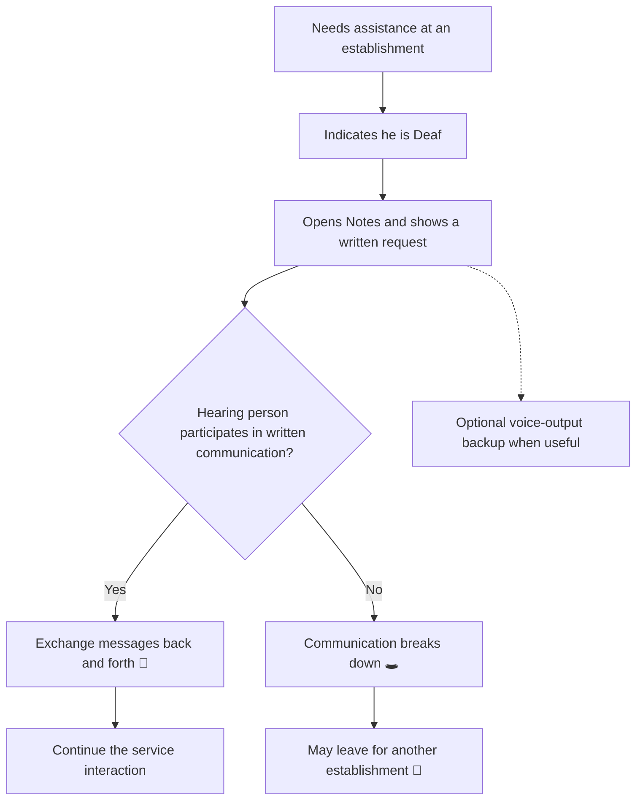
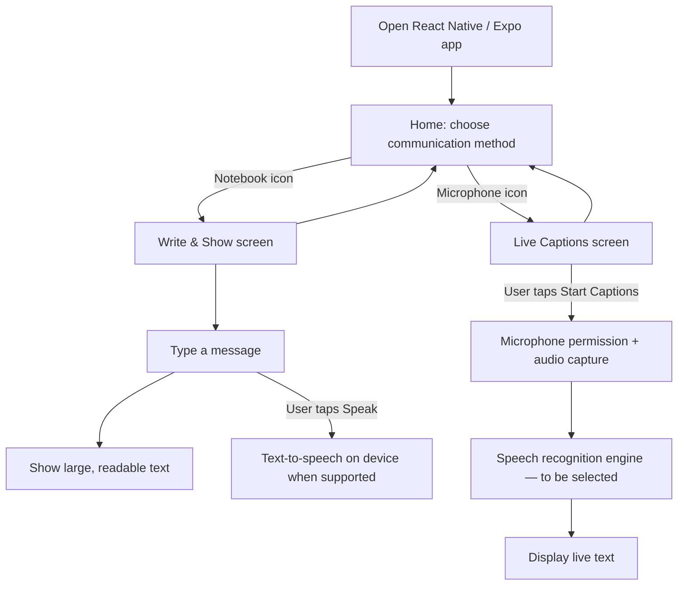
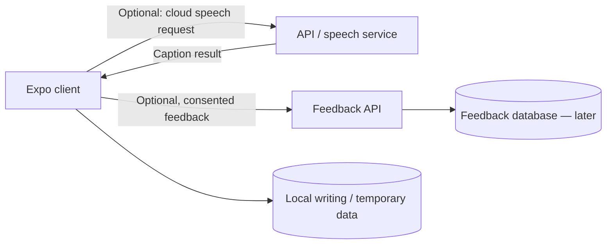

# OpenConversation (Working Title)

> An accessibility-focused mobile communication companion offering two user-selected experiences: **Notebook / Write & Show** for written communication and **Microphone / Live Captions** for reading speech.

**Partner:** Participant A (anonymous Deaf community member) · **Partner's role:** Primary user / discovery partner  
**Team:** [Your name(s)] · **Course:** CMP 464/343 Product 2 · **Last updated:** November 11, 2026  
**Live demo:** See Demo section (not yet deployed)

> **Status:** Discovery and planning. The two-mode interface is a **proposed design**, not an interviewed partner's confirmed request. The primary partner has confirmed a preference for Notes-style writing; live-caption preferences so far come from a separate self-discovery reflection. No prototype or partner usability test has been completed.

---

## 1. About the Partner

Participant A is a Deaf individual who interacts with hearing people in everyday settings such as stores, workplaces, restaurants, school, and family situations. He prefers communicating by exchanging written messages using the Notes app on his phone, rather than relying on lip-reading. He also uses alternative tools when needed.

His goal is to communicate comfortably and complete everyday interactions, including requests such as collecting a package. He reports that some hearing individuals are unfamiliar with written communication accommodations or are unwilling to participate. When an establishment shows little willingness to accommodate his preferred method, he may leave and go elsewhere.

Unlike a business partner, Participant A is an individual end user. **Confirm with the instructor that an individual accessibility partner qualifies for Product 2.** Other Deaf and hard-of-hearing participants may be interviewed for additional perspectives; their needs should not be assumed to match Participant A's. A two-option home screen (**Notebook** and **Microphone**) is a product concept to test, **not** something Participant A requested in the interview.

---

## 2. Discovery Log

### Conversation #1 · [Confirm interview date] · [Confirm format] · with Primary Deaf Participant

- **Their goals:** Communicate comfortably and independently with hearing people; use written communication rather than lip-reading; complete ordinary interactions without needing to persuade others to use an accessible communication method.
- **How the work happens today:** When communicating with a hearing person, Participant A indicates that he is Deaf, sometimes by pointing toward his ear. He opens Notes, types what he needs, shows the message, and may exchange written messages back and forth. During a package pickup, he types that he is Deaf and is there to collect a package. He has a separate voice-output app when spoken output is useful. He uses Ava to read transcribed speech and ZVRS for telephone communication.
- **Pain points (how often · what it costs):** He reports communication difficulties **daily**. Some hearing individuals ask whether he can lip-read or are unwilling to engage in written communication. This causes frustration, stress, and discomfort. When an establishment is unwilling to accommodate him, he may leave and try another establishment. **Number of such visits, minutes lost, and financial impact have not been measured.** He also reports problems using ZVRS under certain mobile-data/Wi-Fi conditions; the exact technical cause is unverified.
- **Tools they use now:** Phone Notes app (preferred); separate voice-output app; Ava; ZVRS for calls.
- **What they've tried / wish existed:** Uses Notes because it is familiar, easy for him, and works offline. Switches to other tools when needed, but reports connectivity or access difficulties with some alternatives. **He has not yet explicitly requested a new application or approved the proposed feature list.**
- **Best quote:** [Insert a verified verbatim quote, with permission. Current notes are mostly paraphrases, not a reliable transcript.]

**Follow-up questions:** How often does he leave an establishment? Which steps of Notes communication are inconvenient? Would a single communication interface improve his experience, or would he rather keep using Notes? What specifically went wrong when using ZVRS over Wi-Fi?

### Conversation #2 · [Confirm date(s)] · Self-discovery reflection · with Hard-of-Hearing Researcher (not the Product 2 partner)

- **Their goals:** Follow multi-speaker conversations, especially while doing other tasks; identify speakers in captions; recover information missed while concentrating.
- **How the work happens today:** Sometimes uses Apple Live Listen and live transcription. Live Listen's microphone position can affect clarity, and amplification sometimes produces an uncomfortable ringing or echo-like effect. Live transcription helps but, in the researcher's experience, captions are not labeled by speaker.
- **Pain points (how often · what it costs):** Difficulty distinguishing soft speech from louder competing voices and following conversations while coding. During a hackathon, the researcher could not understand a soft-spoken teammate, nodded rather than ask for repetition, and never learned what was said. No captioning tool was active then because using a phone while coding felt inconvenient. Exact frequency, time cost, and project consequences have not been measured.
- **Tools they use now:** Apple Live Listen, Apple's live transcription features, Bluetooth headphones.
- **What they've tried / wish existed:** Speaker labels such as Person 1/Person 2; captions on a nearby phone **or** computer depending on the situation (not simultaneous displays); manual Start Captions; occasional glances with the ability to scroll back; access to past captions until the end of the day, followed by automatic deletion. Manual early deletion remains undecided.
- **Best quote:** “I never found out what they said.” [Researcher's own account; use only if appropriate for the submission.]

**Research distinction:** This self-reflection informs the proposed Microphone / Live Captions mode but does **not** substitute for validating the primary Deaf partner's problem or preferences. The idea to show both a Notebook and a Microphone button on the home screen is a design decision made after discovery, not a finding from either interview.

---

## 3. Workflow Map (today)

The workflow below reconstructs Participant A's in-person communication process from the package-pickup example and his account of leaving establishments that do not accommodate him. **Review the precise sequence with him before calling this an observed workflow.**

**Legend:** 🔴 added effort / detour · 🔁 repeated message exchange · 🕳️ interaction may remain unresolved. No measured duration is available.

---

## 4. Problem Statement

> **When** Participant A needs assistance from hearing people during everyday interactions at establishments,  
> **he struggles to** establish effective two-way communication when the other person is unfamiliar with or unwilling to use his preferred written method,  
> **which costs him** frustration, stress, additional effort, and sometimes the need to leave for another establishment. He reports encountering communication difficulties **daily**, but the minutes lost and number of unsuccessful visits have **not been measured**.  
> **This happens because** some hearing individuals lack experience communicating with Deaf people or are unwilling to adapt how they communicate.  
> **Right now he** types and exchanges messages on his phone and uses alternative communication methods when needed, **but** these approaches cannot ensure that another person will participate, and some alternatives have presented connectivity difficulties.

**They'll know this is solved when:** [Proposed criterion to validate with Participant A] He can complete more ordinary interactions through his preferred communication method without having to leave because communication could not be established.

**Evidence gaps:** Ask Participant A how often he leaves, what time or effort is involved, and whether easier written/voice communication would actually change the outcome. The proposed product cannot guarantee another person's willingness to cooperate.

---

## 5. Existing vs Desired Solutions

| Area | Today (existing) | Desired / proposed | Gap |
|---|---|---|---|
| Written communication | Participant A prefers offline Notes and exchanges messages with hearing people. | **Confirmed preference:** retain simple, comfortable writing. **Proposed:** a dedicated Notebook / Write & Show mode. | The partner has **not** said a new interface is better than Notes; some hearing people may still refuse to participate. |
| Spoken response | A separate voice-output app serves as a backup. | **Proposed:** a Speak button within Write & Show. | Whether switching apps is a meaningful burden has not been confirmed by Participant A. |
| Understanding spoken replies | Participant A sometimes uses Ava to read transcribed speech. | **Proposed:** a separate Microphone / Live Captions mode that the user manually starts. | Transcription accuracy, offline capability, and usefulness for the primary partner still need testing. |
| Connectivity | Notes works offline; Participant A reports connectivity issues with some other tools. | **Confirmed preference:** essential written communication should work offline. | Offline live speech recognition is not guaranteed; test the actual phones and recognition engines. |
| Group conversations | Separate self-discovery found captions without speaker labels confusing. | **Researcher preference:** speaker-labeled captions, eventually on a phone or computer. | This is **not** a confirmed requirement from Participant A and is not part of the initial MVP. |
| Mode selection | Notes and other tools are separate experiences today. | **Proposed:** home screen with two large **icon + title + description** choices, plus a way to return home and switch modes. | Usability and partner preference must be validated rather than assumed. |

**Solution type:** **Custom cross-platform app with optional automated functions (provisional).** Two user-controlled modes may make different communication methods easy to access without categorizing people as "Deaf mode" or "Hard-of-Hearing mode." Technology may reduce friction but cannot make an unwilling person cooperate. This must be tested against the partner's existing Notes workflow.

---

## 6. Features & Benefits

**Proposed opening experience:** On launch, show **two large choices**—a **notebook icon labeled "Write & Show"** with the description "Type and display messages," and a **microphone icon labeled "Live Captions"** with the description "Read speech as text." Both are available to any user; no diagnosis- or identity-based mode selection. Keep clear labels, large touch targets, sufficient contrast, screen-reader labels, and an always-visible way back to the mode chooser. **Not yet partner-tested.**

| Feature (what it does) | Benefit for the partner / users | MVP or Later? |
|---|---|---|
| Home screen with two labeled icon buttons (Notebook / Microphone) | Simple choice of communication method without forcing a default | **MVP interface**, proposed; test usability |
| **Write & Show mode:** offline typed message and large readable display | Preserves the writing approach Participant A already prefers | **MVP core**, compare against Notes |
| **Write & Show mode:** tap Speak to read typed text aloud | Optional spoken output without opening a separate app | **MVP candidate**, validate with Participant A |
| **Live Captions mode:** tap Start / Stop, display recognized words | Lets a user read a hearing person's speech when transcription is desired | **MVP stretch**, only if feasible and validated; do not show a dead button |
| Scroll back through earlier captions | Helps recover speech missed while working | **Later / caption-mode improvement**; expressed in self-discovery |
| Temporarily retain captions until end of day and automatically delete them | Lets captions be reviewed later while limiting retention | **Later**, based on self-discovery; privacy and consent review needed |
| Speaker labels (Person 1, Person 2) | May help follow group conversations | **Later**, advanced diarization; accuracy not promised |
| Computer caption viewing | Lets a user choose the best screen for a task | **Later**, no simultaneous cross-device sync required by current self-discovery |
| AI-generated replies and camera-based sign-language interpretation | Possible optional communication tools | **Future research**, not validated for partner |

**MVP (2–3 feature priorities, subject to partner confirmation):**
1. **Mode-selection home screen:** a notebook icon / Write & Show card and a microphone icon / Live Captions card, with descriptive labels.
2. **Working offline Write & Show mode**, including optional text-to-speech if the partner finds it useful.
3. **Functional user-started Live Captions mode** only after testing the available speech-recognition technology and validating demand. If not achievable in the class window, mark it "Coming later" in mockups or omit it from the deployed MVP rather than implying it works.

**Later:** Scrollback and retention in live captions; end-of-day expiration; speaker diarization; improved offline transcription; a web/computer caption viewer; optional user-approved quick replies.

**Not doing (Product 2):** Guaranteed offline speech recognition; automatic sign-language interpretation; reliable identification of all overlapping speakers; always-on microphone recording; permanent cloud transcript storage; unsolicited AI replies; forcing cooperation from unwilling people; user classification by Deaf versus hard-of-hearing labels.

**Acceptance questions to test:** Would Participant A choose Write & Show instead of Notes? Can a new participant recognize what both buttons do without instructions? Can users switch modes without losing control of the conversation?

---

## 7. Tech Stack & Architecture

### Surface

- **Surface:** Cross-platform **mobile** application using React Native with Expo (iOS and Android); optional computer/web companion later.
- **Why:** Participant A already communicates from his phone during everyday interactions. A home screen offering **Notebook / Write & Show** and **Microphone / Live Captions** keeps both communication methods one tap away. The user chooses a **task**, not a disability label. This two-mode approach is a design hypothesis to test.

### Stack

| Piece | Choice | Why |
|---|---|---|
| Front end / interface | **React Native + Expo + TypeScript**, optionally Expo Router | Cross-platform mobile codebase; home screen routes to separate Write & Show and Live Captions screens. |
| Back end / automation logic | **No required server for first offline writing prototype**. Add a Node.js/Express API only if justified by speech recognition or feedback requirements. | Keep core written communication usable offline and avoid unnecessary infrastructure. |
| Data | React state initially; **expo-sqlite** if local phrases or caption history are later needed | Simple local-first design, with no cloud transcript database by default. |
| Outside services / APIs | **expo-speech** for text-to-speech; **speech recognition engine to be evaluated** | Speech synthesis and speech recognition are different capabilities. Recognition may require native integration or a cloud service. |
| Hosting / where it runs | iOS / Android builds with Expo's testing and build tools; deployment not yet configured | Can test native-device features before planning public beta distribution. |

### Architecture

**Navigation first:** Opening the application displays two large, labeled choices; each has its own screen. Users can return to the home screen and select the other mode.

**How client → API → database could fit later:** The **Expo app is the client**. If cloud speech processing is required, it sends authorized audio to an **API / recognition service** and receives caption text. If the user voluntarily submits app feedback, the client could send **feedback-only data** to an API and a database. Neither the API nor cloud database is required for basic offline writing, and conversation transcripts should **not** be sent to a feedback database.

**Privacy / constraints:** Do not silently retain voices or transcripts. Before capturing conversations, provide clear microphone indicators and appropriate notice/consent. Offline writing should work without internet, but **offline recognition remains unproven**. Automatic end-of-day deletion is a self-discovery preference for a later caption-history feature, not yet a confirmed partner requirement; if implemented, expired content must not reappear when the app reopens.

---

## 8. Solution Brief (for your partner)

**The problem we heard:** You prefer writing messages to communicate with hearing people. Some people do not know how to communicate with you this way, and some do not want to participate. When that happens, you may feel uncomfortable and choose another establishment.

**What we're building:** We are proposing a simple phone application that opens with **two clear options**: a **notebook for Write & Show** and a **microphone for Live Captions**. Write & Show lets you type and display a message and may let you speak it aloud. Live Captions would let you read someone else's spoken words, if testing shows it works well enough.

**How it will help:** Our aim is to make written communication easy to access and to offer a backup without forcing you to change your preferred method. We **have not** demonstrated that this is better than Notes or that it saves time, so we want your feedback before committing to the final features.

**What you'll need to do:** Choose a mode, write or read messages, and tell us in a voluntary test what feels comfortable, unnecessary, or confusing. You should be able to switch modes, but the other person's willingness to communicate will still matter.

**What it won't do (yet):** It will not translate sign language through the camera, guarantee accurate captions in noisy rooms, always work without internet for speech transcription, or make an unwilling person cooperate. Written messages are intended to work offline.

**Partner approval:** This two-mode screen and feature set are a **proposal to show Participant A**, not something he has requested or approved.

---

## 9. Demo

**Status:** No working demo or deployment yet.

**Planned under-two-minute demo, after a functional prototype exists:**
1. Open the app and show the **two large home-screen buttons**: **Notebook — Write & Show** and **Microphone — Live Captions**, each with a one-line description.
2. Tap **Write & Show**, type a package-pickup request while offline, and display it in large text.
3. If implemented, tap **Speak** to hear that typed message on the test phone.
4. Return home and tap **Live Captions**. **Only demonstrate this step if genuine transcription works** on the device; show permission, Start / Stop, and visible captions.
5. Invite Participant A to test the flow and compare it with Notes. Record permission-based feedback about whether the mode choice feels intuitive and useful.

**Screenshots, GIF, video, or live link:** [Add real evidence after the prototype exists. Do not add a broken screenshot reference.]

---

## 10. Partner Feedback

**Date and format:** [Pending prototype test — not yet conducted]

- **Quote 1:** [Pending verified, permission-approved direct quote]
- **Quote 2:** [Pending verified, permission-approved direct quote]

**What worked:** [Not yet tested]  
**What didn't / was confusing:** [Not yet tested]  
**What they'd want next:** [Not yet tested]

**Test specifically:** Would the partner prefer the Notes-like screen over Notes? Can they identify the **Notebook** and **Microphone** mode buttons immediately? Is switching between modes straightforward? Is the captioning option actually helpful to them? Accept negative feedback as evidence, not a failure.

---

## 11. Team (pairs only)

[If working in a pair, add the table below with actual responsibilities. If working solo, mark this section “Not applicable — solo project,” if the instructor permits.]

| Teammate | What I did (discovery, features, files) |
|---|---|
| [Name, if applicable] | [Actual contributions] |

---

## 12. What We Learned

**Learning so far:** I originally imagined a live-captioning application with many automated features. Interviewing Participant A showed that his trusted method is already a simple, offline Notes workflow. His largest reported difficulty is often another hearing person's unfamiliarity with—or unwillingness to participate in—written communication. Better technology cannot guarantee that cooperation. A separate hard-of-hearing self-discovery reflection highlighted different needs: reading group speech, identifying speakers, and reviewing missed captions while focused on coding.

**Design decision under consideration:** Instead of assuming one communication workflow suits everyone, I proposed **one mobile app that starts with two large, labeled mode buttons**: **Notebook / Write & Show** and **Microphone / Live Captions**. The buttons describe an activity rather than labeling users as Deaf or hard of hearing. **This is a proposed design, not a partner-validated feature.**

**How I investigated:** Interviewed the primary Deaf participant, wrote a current-workflow map from a package-pickup example, gathered self-discovery notes about group conversations, used the course's spec template, and used AI assistance to structure findings and distinguish confirmed evidence from assumptions.

**What AI could get wrong:** Generated direct quotes, invented numerical costs, interpreting a willingness-to-accommodate problem as solely technological, assuming Participant A wants a unified two-mode app, or claiming Expo inherently offers fully offline, reliable live speech recognition. No feature is validated just because it looks promising on a mockup.

**What I'd do differently / next:** Verify the interview date and exact partner quotes; confirm the workflow with Participant A; measure the frequency and effects of leaving establishments; show a simple two-button home-screen mockup; test whether Write & Show improves on Notes; validate whether Live Captions is valuable to the partner; and build/test only technically feasible features before submitting a demo.

**Status:** Discovery and planning. Development and partner feedback are pending.
